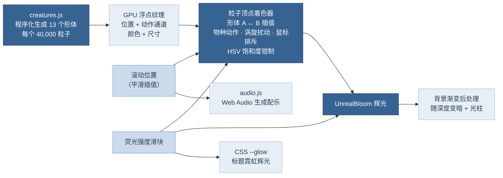

# 深蓝潜行 · Into the Deep

一个以海洋生物为主题的滚动粒子网页，交互形式参考 [usta.agency](https://usta.agency)。页面从夜海的“蓝眼泪”出发，一路下潜到 4,000 米的无光层。随着滚动，四万颗低饱和荧光粒子依次聚散成 11 种海洋生物，每一页都配有中文说明，并配有随水深变化的实时生成配乐。

| 顺序 | 生物 | 英文标题 | 水层 |
|---|---|---|---|
| 00 | 海面（首页） | INTO THE DEEP | 透光层 |
| 01 | 珊瑚 | CORAL | 透光层 |
| 02 | 海星 | STARFISH | 透光层 |
| 03 | 海马 | SEAHORSE | 透光层 |
| 04 | 鲎 | HORSESHOE CRAB | 透光层 |
| 05 | 海龟 | SEA TURTLE | 透光层 |
| 06 | 魔鬼鱼（蝠鲼） | MANTA RAY | 透光层 |
| 07 | 鲨鱼 | SHARK | 透光层 |
| 08 | 蓝鲸 | BLUE WHALE | 弱光层 |
| 09 | 水母 | JELLYFISH | 弱光层 |
| 10 | 灯笼鱼 | LANTERNFISH | 弱光层 |
| 11 | 鮟鱇（深海“灯笼鱼”） | ANGLERFISH | 无光层 |
| ∞ | 深渊（结尾） | THE ABYSS | 无光层以下 |

“灯笼鱼”在分类学上指灯笼鱼科（Myctophidae），口语里也常指头顶挂着“灯笼”的深海鮟鱇，所以两者都做了。

## 运行

页面使用 ES Module，需要通过本地服务器打开，直接双击 `index.html` 不行：

```bash
python3 -m http.server 8080
# 或
npx http-server -p 8080 -c-1 .
```

然后访问 <http://localhost:8080>。浏览器需要支持 WebGL2（近几年的 Chrome、Edge、Firefox、Safari 均可）。

## 实现方案



### 1. 粒子形体（`assets/js/creatures.js`）

没有使用任何外部 3D 模型，每种生物都由几类“部件”采样拼成：

- **放样体**：沿身体轴线给出背、腹、侧三个方向的半径剖面，用于鲨鱼、蓝鲸、灯笼鱼、鮟鱇。
- **管道**：沿任意 3D 样条加半径，用于海马身体、触手、鲎的尾剑、蝠鲼头鳍、鮟鱇钓竿。
- **鳍面 / 多边形膜**：用前缘与后缘曲线，或平滑后的多边形定义，用于各种鳍、海龟鳍肢、鲸尾、柳珊瑚扇。
- **穹顶与球面**：用于龟甲（按盾片中心做 Voronoi 式分区着色）、鲎的头胸甲（中脊、侧脊、复眼）、水母伞盖（16 条辐管、环管、四叶生殖腺）、脑珊瑚（迷宫纹）。
- **递归分枝**：用于鹿角珊瑚和柳珊瑚扇。

每个部件按面积分配粒子数。每个粒子写入位置、颜色、尺寸，以及一个“动作通道”：整数部分是部件分组，小数部分是动作权重。所有形体打乱顺序后写进一张浮点纹理。打乱有两个作用：变形时粒子随机配对，而移动端只取前 22,000 个粒子时仍是均匀抽样。

### 2. 变形与动作（`assets/js/shaders.js`）

- 顶点着色器用 `gl_VertexID` 从纹理里同时取出相邻两个形体的数据，按滚动进度插值。每个粒子都有随机延迟，途中还叠加水流般的涡旋，看起来像“溶解后重组”。
- 每个物种在着色器里有各自的动作：鲨鱼、灯笼鱼左右摆尾，蓝鲸上下摆动尾鳍，蝠鲼的振翅波从翼根传到翼尖，水母伞盖快缩慢放、触手延迟跟随，海龟前鳍肢同步划水，海马背鳍高频扇动，珊瑚和海草随流摆动，鮟鱇的拟饵明灭闪烁。
- 鼠标在屏幕空间推开附近的粒子。

### 3. 低饱和荧光与可调强度

- **低饱和是硬约束**：着色器把每个粒子的颜色转到感知空间，求出 HSV 饱和度，超过 `uSatMax = 0.42` 的部分按比例压回，色相和明度保持不变。因此无论调色板里写了什么颜色，最终渲染出来都是低饱和的。
- **荧光**：每个粒子由一个高斯核心加一圈指数光晕组成，加色混合后再经过 UnrealBloom 辉光。发光器、拟饵这类大尺寸粒子还会单独脉动。
- **荧光强度滑块**（右上角，0–100%）同时控制：粒子光晕的半径与亮度、Bloom 的强度与半径、标题霓虹的 `drop-shadow` 层级（CSS 变量 `--glow`）。设置会存进浏览器本地存储。
- 不同生物的粒子在屏幕上的密度差别很大，所以每一页都按“缩放 × 每单位像素数”的平方做了亮度补偿，手机和大屏上看起来一致。

### 4. 配色

- 粒子：每种生物都有自己的多色调粉彩调色板（珊瑚粉、杏色、薰衣草、薄荷、琥珀、珍珠白、浅水绿等），比原网页的配色丰富得多。所有蓝色调都取自 Loyel 渐变蓝色板（`#376392`、`#497DAE`、`#6C9AC4`、`#9FBDDA`、`#CCDBEB`、`#E8EEF6`）。
- 界面与背景：全部使用 Loyel 色板。深海底色由 `#263B54` 按比例压暗得到，随下潜逐步变黑。

### 5. 字体

- 首页大标题和每页的英文动物名使用 **Oswald**，做成**中空描边**（`-webkit-text-stroke`），外层再叠三层 Loyel 蓝 `drop-shadow` 形成蓝色荧光。只描边不填充，所以字心保持中空。
- 中文说明使用 Noto Sans SC，学名使用 Cormorant Garamond 斜体。
- 字体替换：如果需要换成别的展示字体，只改 `assets/css/style.css` 顶部的 `--font-display`，并更新 `index.html` 里的 Google Fonts 链接即可。

> 【待确认】开发环境的网络策略拦截了 usta.agency，没能直接读取它的样式表。Oswald 是根据 Awwwards 字体索引（该站被列在 Oswald 名下）判断的。如果你在浏览器开发者工具里看到原站用的是别的字体，按上面的方法替换即可。

### 6. 配乐（`assets/js/audio.js`）

全部用 Web Audio 实时合成，不加载任何音频文件：

| 层 | 做法 | 随场景变化 |
|---|---|---|
| 海浪 | 褐噪声 → 低通 → 0.075 Hz 慢速起伏 | 越深截止频率越低，声音越闷 |
| 和弦铺底 | 5 个声部（三角波 + 正弦，轻微失谐）→ 呼吸般的低通滤波 | 透光层 D 大调明亮，弱光层 E 多利亚朦胧，无光层 D 小调低沉；约 12 秒换一次和弦并滑音过渡 |
| 低音 | 正弦波跟随和弦根音 | 同上 |
| 钟琴 | FM 合成的玻璃感音色，大量送入混响 | 水母页改为竖琴般的上行琶音，灯笼鱼页升高八度、更密集，鮟鱇页降低八度、更稀疏 |
| 气泡 | 正弦快速上滑的短音簇 | 只在浅水页出现 |
| 鲸歌 | 低频滑音 + 4–5 Hz 颤音 + 共振峰滤波 | 主要在蓝鲸页 |
| 声呐 | 柔和的正弦回响 | 只在深渊页 |
| 混响 | 程序生成的 4.8 秒脉冲响应 | — |

浏览器要求用户手势后才能出声，所以首页提供“开启配乐，开始下潜”按钮，右上角也可以随时开关和调节音量。切到其他标签页时会自动暂停。

### 7. 适配

- 宽屏：文案和生物左右交替。生物自动居中放进文案旁的空白区域，并按可用宽度缩放。
- 竖屏 / 手机：生物在上半屏，文案卡片在下方，带渐隐底衬；粒子数降到 22,000，像素比上限 1.5。
- `prefers-reduced-motion`：生物动作幅度和变形涡旋都降到 35%，并关闭标题闪烁。

## 目录结构

```
index.html                     页面结构与全部文案
assets/css/style.css           样式（Loyel 色板 token、中空荧光标题、响应式）
assets/js/main.js              场景表、滚动驱动、布局、渲染循环、控件
assets/js/creatures.js         13 个粒子形体的程序化生成
assets/js/shaders.js           粒子 / 背景 / 海雪着色器
assets/js/audio.js             Web Audio 生成配乐
assets/js/vendor/three.bundle.min.js   精简打包的 three.js r186（含 Bloom 后处理）
tools/three-entry.js           重新打包 three.js 的入口
```

重新打包 three.js：`npm install && npm run vendor`。

## 想加一种新生物？

1. 在 `creatures.js` 里写一个返回 `{ fit, parts }` 的函数，加入 `BUILDERS` 和 `SHAPES`。
2. 在 `shaders.js` 的 `animate()` 里给它一个 `K_*` 编号和动作。
3. 在 `main.js` 的 `SCENE` 表里加一行（朝向、亮度、背景、配乐密度），在 `index.html` 里加一个对应的 `<section>`。

## 文案事实依据

文案是科普级的概括，主要依据：IUCN 红色名录（巨型蝠鲼、蓝鲸、中国鲎的濒危等级）、《国家重点保护野生动物名录》（2021，中国鲎为二级）、2008 年诺贝尔化学奖（GFP）、Jensen 等（2018，*Current Biology*，大堡礁北部绿海龟幼龟高度雌性化）、Ari 与 D'Agostino（2016，*Journal of Ethology*，蝠鲼镜像实验，属初步证据）、Seabed 2030（2024 年约 26% 的海底完成现代精细测绘）。
