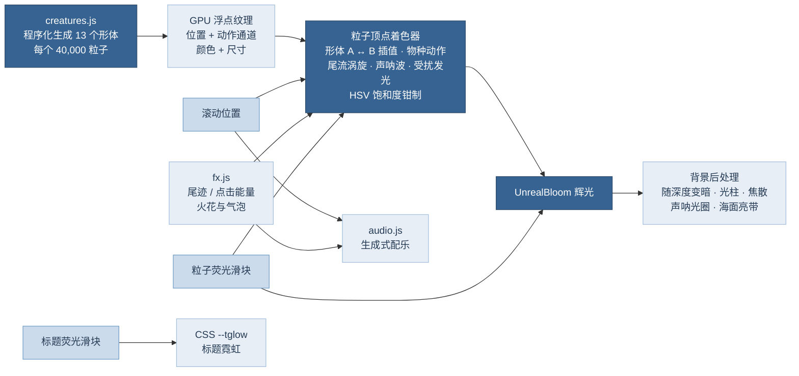

# 深蓝潜行 · Into the Deep

一个以海洋生物为主题的滚动粒子网页，交互形式参考 [usta.agency](https://usta.agency)。页面从夜海的“蓝眼泪”出发，一路下潜到 4,000 米的无光层。随着滚动，四万颗低饱和荧光粒子依次聚散成 11 种海洋生物，每一页都配有中文说明，并配有随水深变化的实时生成配乐。

> 本仓库里还有另一个页面：**[意式轻奢 · 3D 户型漫游](home3d/README.md)**（`home3d/`）——按户型图比例搭建的可交互 3D 家居网页，双击 `home3d/index.html` 即可打开。

| 顺序 | 生物 | 英文标题 | 水层 |
|---|---|---|---|
| 00 | 海面（首页） | INTO THE DEEP | 透光层 |
| 01 | 珊瑚 | CORAL | 透光层 |
| 02 | 海星 | STARFISH | 透光层 |
| 03 | 海马 | SEAHORSE | 透光层 |
| 04 | 鲎 | HORSESHOE CRAB | 透光层 |
| 05 | 海龟 | SEA TURTLE | 透光层 |
| 06 | 魔鬼鱼（蝠鲼） | MANTA RAY | 透光层 |
| 07 | 鲨鱼 | SHARK | 透光层 |
| 08 | 蓝鲸 | BLUE WHALE | 弱光层 |
| 09 | 水母 | JELLYFISH | 弱光层 |
| 10 | 灯笼鱼 | LANTERNFISH | 弱光层 |
| 11 | 鮟鱇（深海“灯笼鱼”） | ANGLERFISH | 无光层 |
| ∞ | 深渊（结尾） | THE ABYSS | 无光层以下 |

“灯笼鱼”在分类学上指灯笼鱼科（Myctophidae），口语里也常指头顶挂着“灯笼”的深海鮟鱇，所以两者都做了。

## 打开方式

- **直接双击 `index.html`** 即可，不需要服务器，也不需要联网。它是构建好的单文件版：three.js、全部脚本、样式和英文字体都内联在这一个文件里（约 800 KB）。联网时中文会使用 Noto Sans SC，离线时回落到系统中文字体。
- 开发时请改源文件 `index.dev.html` 与 `assets/`，用本地服务器打开（ES Module 不能从 `file://` 加载），改完后重新构建单文件版：

```bash
npm install          # 安装 esbuild 与 three（只在构建时需要）
npm start            # 本地服务器，打开 /index.dev.html
npm run build        # 重新生成单文件版 index.html
```

浏览器需要支持 WebGL2（近几年的 Chrome、Edge、Firefox、Safari 均可）。

> 上一版下载后无法打开的原因：旧的 `index.html` 用 `<script type="module">` 加载 `assets/js/` 下的多个文件，浏览器在 `file://` 下会以跨域为由拦截这类加载，页面就停在“正在准备粒子”。现在的 `index.html` 是单文件版，已用无界面 Chromium 从 `file://` 打开验证过。

## 页面上可以做什么

| 操作 | 效果 |
|---|---|
| 滚动 | 粒子在相邻两种生物之间“溶解—重组”；右侧深度计实时显示下潜深度与水层 |
| 鼠标划过 | **生物荧光尾流**：像手掌拨过海水，粒子被尾流拖拽、卷成左右交替的小涡旋，被惊扰的粒子亮起冷色荧光（夜光藻受扰发光）；划过的地方还会留下一串发光的浮游生物 |
| 点击 | **声呐脉冲**：一圈波纹从点击处扩散，推开粒子并让波前经过的粒子闪光，同时迸出火花和气泡。**点得越快越强**：连击会累积“能量”，波纹更大更亮、气泡更多，强连击时画面会轻微震动 |
| 右上角「荧光调节」 | 三个滑块：**粒子荧光**（粒子光晕与辉光）、**标题荧光**（英文标题外层蓝色荧光）、**配乐音量**。设置会自动记住 |
| 右上角「配乐」 | 开关配乐（浏览器要求用户点一下才能出声） |
| 结尾「返回海面」 | 一路上浮，所有生物倒放，气泡涌起 |

## 实现方案



### 1. 粒子形体（`assets/js/creatures.js`）

没有使用任何外部 3D 模型，每种生物都由几类“部件”采样拼成：放样体（鱼身、鲸身）、沿样条的管道（触手、海马身体、鲎的尾剑）、鳍面与平滑多边形膜（各种鳍、鳍肢、鲸尾、柳珊瑚扇）、穹顶（龟甲盾片、鲎的头胸甲、水母伞盖）以及递归分枝（鹿角珊瑚）。每个粒子写入位置、颜色、尺寸和一个“动作通道”（整数部分是部件分组，小数部分是动作权重），所有形体打乱后写进一张浮点纹理。

### 2. 变形、动作与交互（`assets/js/shaders.js`、`assets/js/fx.js`）

- 顶点着色器用 `gl_VertexID` 同时取出相邻两个形体，按滚动进度插值；每个粒子随机错峰，途中叠加水流涡旋。
- 每个物种有自己的动作：鲨鱼与灯笼鱼摆尾、蓝鲸上下摆尾、蝠鲼振翅、水母伞盖快缩慢放、海龟划水、海马背鳍高频扇动、珊瑚随流摆动、鮟鱇拟饵明灭。
- **尾流**：鼠标最近 16 个采样点（位置、速度、年龄）作为 uniform 数组传入。每个点让附近粒子沿速度方向被拖拽，并绕采样点做正反交替的旋转位移，形成类似卡门涡街的涡旋；扰动强度同时转化为亮度，并把颜色推向冷色荧光。粒子本身无状态，尾迹老化后会自然恢复原形。
- **声呐**：最近 8 次点击作为 uniform 数组，计算一圈向外扩散的高斯波前：推开粒子、波前闪光，背景后处理里同步画出光圈。连击能量每次点击 +1、按约 0.65 秒的时间常数衰减，强度 = 0.35 + 0.42 × 能量（上限 3）。
- 火花与气泡是一套独立的 1,800 粒子环形缓冲区：浮游生物火花迅速散开后缓慢漂散；气泡带浮力加速上升、左右摇摆，用亮边加高光的环形精灵绘制。

### 3. 低饱和荧光与两个可调强度

- **低饱和是硬约束**：着色器在感知空间求出每个粒子的 HSV 饱和度，超过 0.42 的部分按比例压回。受扰发光的冷色调也在钳制之前混入，所以仍然是低饱和的。
- **粒子荧光**（0–100%）控制：粒子光晕半径与亮度、Bloom 强度与半径、火花大小。
- **标题荧光**（0–100%）控制：英文标题外三层 `drop-shadow` 的半径和不透明度（CSS 变量 `--tglow`）。
- 每一页按“缩放 × 每单位像素数”的平方做亮度补偿，手机和大屏上看起来一致。

### 4. 字体（与原网页一致）

开发环境无法直接访问 usta.agency。调研工作流从三个方向检索，在一份公开的第三方存档里找到了该站自己的样式表副本（`_astro/hoisted.d75b784e.css`）：

- **标题**：`Oswald Variable`（Fontsource，字重 200–700），标题用 600、全大写。本页的英文大标题与每页动物名用的就是同一个 Oswald 可变字体文件。
- **正文与小字**：`Montserrat Variable`（Fontsource，100–900）。本页把它用在所有拉丁字母和数字上（字体栈 `Montserrat → Noto Sans SC`）。中文和中文标点交给 Noto Sans SC，因为 Montserrat 的 `unicode-range` 只覆盖拉丁字符。
- 学名使用 Cormorant Garamond 斜体。
- 三种英文字体都放在 `assets/fonts/`（SIL OFL 1.1，许可文件在同一目录），构建单文件版时内联为 data URI。

标题做成**中空描边**（`-webkit-text-stroke`，颜色是 Loyel `#9FBDDA`，比上一版的近白色更蓝），外层叠三层 Loyel 蓝光晕（`#6C9AC4` / `#497DAE` / `#376392`）。

### 5. 动效

| 位置 | 动效 |
|---|---|
| 加载幕 | 声呐圈从标题中心扩散 |
| 英文标题 | 每个字母是一支独立的“灯管”，进入视野时按随机次序闪烁点亮；之后偶尔有某个字母接触不良地闪一下 |
| 离开首页 | 标题像穿过海面一样放大、虚化、淡出；滚过首页约 40% 时，一道波动的海面亮带向上掠过，一大片气泡从下方涌起 |
| 快速滚动 | 海雪被拉成细长的速度线，越快越明显 |
| 穿越水层（200 m / 1,000 m / 4,000 m） | 横幅提示进入的水层与特征，屏幕中心发出一圈声呐波，配乐给出短促的过渡音效 |
| 浅海页 | 背景上方出现水面焦散光纹和光柱，越深越弱 |
| 每个生物页 | 背景里有一个超大的描边章节号，以不同速度视差滚动 |
| 光标 | 潜水灯般的光环，点击时随连击能量放大 |
| 返回海面 | 平滑上浮 2.6 秒，粒子倒放所有生物，气泡涌起 |

`prefers-reduced-motion` 下，动作、涡旋、震动都会减弱，焦散、速度线和标题闪烁会关闭。

### 7. 适配

- 宽屏：文案与生物左右交替，生物自动居中放进文案旁的空白区域，并按可用宽度和高度缩放。
- 窄屏（≤ 760 px，含横放的手机）与竖屏（含竖放的平板）：生物在上，文案卡片在下方，带渐隐底衬；手机上粒子数降到 22,000，像素比上限 1.5。
- 触屏上轻点画面即发出声呐脉冲（按下与抬起位置相近、时间很短才算轻点，滑动滚动不会误触发）。
- 画布按“大视口”高度铺满，手机地址栏收起/展开时不会反复重建渲染目标；切换显示器或缩放导致像素比变化时会自动重算；WebGL 上下文丢失后恢复时自动继续渲染。

### 6. 配乐（`assets/js/audio.js`）

由 Web Audio 实时合成，不加载任何音频文件，也不使用 AudioWorklet（所以单文件版从 `file://` 打开也能出声）。

- **调性与速度**：D 小调，56 BPM，固定节拍网格，用前瞻调度器排音。
- **和声**：透光层与弱光层是 Dm9 – B♭maj9 – Fmaj9 – Cadd9（i–VI–III–VII），每个和弦 2 小节。无光层换成更暗的 Dm(add9) – B♭maj7 – Gm9 – A7sus4，深渊层每个和弦拉长到 4 小节。两组持续音轮流承担和弦、交叉淡入淡出，没有滑音。
- **主旋律动机**：一段 8 小节旋律，由柔和的玻璃 / 卡林巴音色演奏，经过附点八分音符的乒乓延迟和混响，每隔一轮出现一次，并随深度变奏（升降八度、只奏首句、按两倍时值演奏）。
- **层次**：和弦铺底、浅海高空泛音、根音次低音、海浪噪声。弱光层加入八分音符琶音，无光层与深渊层加入闷心跳、稀疏声呐和深海低鸣。
- **场景点缀**：蓝鲸页鲸歌，水母页竖琴琶音，灯笼鱼页发光器般的高音光点，鮟鱇页诱饵光长音，深渊页长音。
- **深度**：一个“水下”主低通滤波器随下潜深度连续压低截止频率，把整首曲子粘在一起。
- **交互音效**：点击是与当前和弦协和的声呐“叮”加一串气泡，强度随连击增强；穿越水层有短促的低音涌动加声呐扫频；返回海面是上升的滤波噪声加气泡云。
- **安全**：所有一次性声音播放完即断开，每类声音都有并发上限，输出端有压缩、软削波和限幅，疯狂点击也不会削顶。

## 目录结构

```
index.html                     单文件版（构建产物，可直接双击打开）
index.dev.html                 开发用页面：结构与全部文案
assets/css/style.css           样式（Loyel 色板 token、中空荧光标题、面板、横幅、光标、响应式）
assets/js/main.js              场景表、滚动驱动、布局、渲染循环、事件
assets/js/creatures.js         13 个粒子形体的程序化生成
assets/js/shaders.js           粒子 / 背景后处理 / 海雪 / 速度线 / 火花与气泡着色器
assets/js/fx.js                尾流、声呐点击、连击能量、火花与气泡
assets/js/ui.js                荧光调节面板、逐字霓虹、自定义光标、水层横幅、提示
assets/js/audio.js             Web Audio 生成式配乐
assets/js/vendor/three.bundle.min.js   精简打包的 three.js r186（含 Bloom 后处理）
assets/fonts/                  Oswald / Montserrat / Cormorant Garamond（woff2 + OFL 许可）
tools/build.mjs                生成单文件版 index.html
tools/three-entry.js           重新打包 three.js 的入口（npm run vendor）
home3d/                        另一个页面：3D 户型漫游（说明见 home3d/README.md）
tools/build-home3d.mjs         生成 home3d/index.html 单文件版（npm run home3d:build）
```

## 想加一种新生物？

1. 在 `creatures.js` 里写一个返回 `{ fit, parts }` 的函数，加入 `BUILDERS` 和 `SHAPES`。
2. 在 `shaders.js` 的 `animate()` 里给它一个 `K_*` 编号和动作。
3. 在 `main.js` 的 `SCENE` 表里加一行（跨度、高度、朝向、亮度、背景），在 `index.dev.html` 里加一个对应的 `<section>`。如果需要专属配乐点缀，在 `audio.js` 的场景表里加一项。
4. `npm run build` 重新生成 `index.html`。

## 文案事实依据

文案是科普级的概括，主要依据：IUCN 红色名录（巨型蝠鲼、蓝鲸、中国鲎的濒危等级）、《国家重点保护野生动物名录》（2021，中国鲎为二级）、2008 年诺贝尔化学奖（GFP）、Jensen 等（2018，*Current Biology*，大堡礁北部绿海龟幼龟高度雌性化）、Ari 与 D'Agostino（2016，*Journal of Ethology*，蝠鲼镜像实验，属初步证据）、Seabed 2030（2024 年约 26% 的海底完成现代精细测绘）。水层横幅：透光层约 0–200 m，弱光层约 200–1,000 m，无光层约 1,000–4,000 m，深渊层 4,000 m 以下（水压约每 10 m 增加 1 个大气压）。
