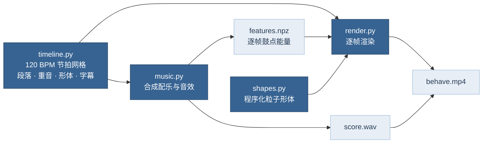

# 行为 · BEHAVE —— 124 秒浓缩视频

把 Robert M. Sapolsky《Behave: The Biology of Humans at Our Best and Worst》（2017；中译本《行为》）浓缩成一支 2 分 04 秒的视频：画面由光、影和荧光粒子组成，配一段热血、燃的史诗配乐，每个转场、字幕和粒子爆发都卡在鼓点上。

- 成片：`behave.mp4`（1920×1080，30 fps，H.264 + AAC 256 kbps）
- 画面、配乐和音效**全部由代码程序化生成**，没有使用任何素材库、采样、模型或图片；字体为 SIL OFL 开源字体
- 片尾注明“读书浓缩视频，非官方作品”

## 叙事结构

全书的组织方式就是这支片子的骨架：一个行为发生了，把时间一路倒回去，看 1 秒前、几分钟前、几天前……直到几百万年前分别发生了什么（第 2–10 章）；再用这套框架去看“我们与他们”、等级、道德、共情、自由意志、战争与和平（第 11–17 章）。

| 时间 | 小节 | 段落 | 画面（粒子形体） | 字幕要点 | 配乐与音效 |
|---|---|---|---|---|---|
| 0:00 | 0–4 | 序幕 | 一粒光种子随心跳搏动 → 尘云 → 封面人形（左绿右橙） | 同一个动作 / 最坏的一面（橙半身亮）/ 最好的一面（绿半身亮） | 低频持续音、心跳、玻璃铃、上升音、反向镲 |
| 0:08 | 4–8 | 片名 | 人形炸开，重组成 **BEHAVE**，一道扫光掠过 | 人类最好与最坏行为背后的生物学 | **主冲击**：次低频 + 金属撞击 + Braam 铜管 + 合唱 |
| 0:16 | 8–12 | 提问 | 钟面 + 纵深时光隧道，彗尾指针逆时针越转越快 | 一个行为发生了 / 我们得一路倒带 | 钟摆嘀嗒（第 11 小节加速）、倒带声、上升音 |
| 0:24 | 12–30 | 倒带阶梯（9 级，每级 2 小节） | 大脑（橙色杏仁核、绿色前额叶）→ 眼睛（瞳孔随鼓点缩放）→ 睾酮甾体母核 → 神经元（树突生长、每拍一次动作电位）→ 成熟波由后向前扫过大脑 → 子宫里的胎儿（心跳）→ DNA 双螺旋 → 集体与个体两种人群 → 生命之树 | 1 秒前 · 神经系统 … 数百万年前 · 进化；底部时间轴逐级点亮 | 弦乐 16 分音符顿弓、太鼓、低音，三段递进（加军鼓 → 加合唱与铜管主题）；每级一次阶梯冲击 |
| 1:00 | 30–32 | 汇聚 | 人形 + 时间尺度光环；随后全部粒子内爆成一点 | 所有这些，都汇聚在同一秒 | 主冲击；第 31 小节第 3 拍**全曲抽空**，只剩反向吸气 |
| 1:04 | 32–36 | 主题词蒙太奇 | 粒子每 2 拍重组成一个词 | 我们与他们 / 等级 / 服从 / 道德 / 共情 / 隐喻 / 自由意志 / 战争与和平 | 每个词一记太鼓 + 低频冲击 + 故障音 + 呼啸 |
| 1:12 | 36–40 | 我们与他们 | 绿、橙两群人对峙 → 混色围成一个圆 | 不到十分之一秒就分出“我们”和“他们” / 边界可以被重新划定 | 逐渐收束、下降音 |
| 1:20 | 40–48 | 希望 | 24 个光团代表一群狒狒：橙色好斗者躁动 → 熄灭下沉 → 新成员从右侧进入、被同化成绿色 → 全体上升蓄力 | 肯尼亚，一个狒狒群 … 狒狒能改变，我们也能 | 钢琴琶音与旋律、心跳；最后两小节军鼓滚奏 + 上升音 |
| 1:36 | 48–56 | 终章 | 人形 + 7 道光环，随“神经 / 感官 / 激素 / 经验 / 基因 / 文化 / 进化”逐拍点亮；橙色半身由下而上转绿（留几点火种）；人形化为白光 | 行为，从来没有单一的原因 / 少一些最坏，多一些最好 / 去做那件更难、但正确的事 | 全编制：合唱 + 铜管主题 + 太鼓 + 弦乐 |
| 1:52 | 56–62 | 片尾 | **BEHAVE** 重现，随后向上飘散 | 《行为》· ROBERT M. SAPOLSKY · *It’s complicated.* | D 大调解决（皮卡第三度）、最后一记冲击、钢琴低音 |

## 卡点是怎么做的



- **同一份时间轴**：120 BPM 下 1 拍 = 0.5 秒 = 15 帧，1 小节 = 60 帧。所有冲击、转场、字幕都写成“第几小节第几拍”，配乐和画面从同一个 `timeline.py` 读取，所以重音和画面在帧级别对齐。
- **设计好的重音**（`HITS`，共 34 个）同时驱动：音频端的低频冲击 / 太鼓 / 镲片 / 呼啸，画面端的闪白、镜头震动、冲击缩放、色散、粒子向外爆发和光晕增强。大冲击前 0.45 秒粒子会先向内收缩，与反向镲同步。
- **音频反应**：配乐渲染完成后，把鼓组与冲击总线的包络按帧导出（`features.npz`），粒子亮度、杏仁核与瞳孔、背景光束都随它跳动，连没有专门设计的小鼓点也能“踩”上。

## 光、影与配色

- 背景压到接近纯黑，光只来自三处：粒子自身、顶部体积光束、由亮粒子径向模糊出的光柱；配合多级辉光、横向镜头光晕、景深散景和暗角，形成明暗对比。
- 蓝色全部取自 Loyel 渐变蓝色板（`#F4F7FB` → `#263B54`）。绿色 `#9CC448` 与橙色 `#E08A3C` 取自原书封面的两种粒子色，并沿用封面的语义：**绿 = 我们最好的一面，橙 = 我们最坏的一面**。

## 重新生成

```bash
pip install numpy scipy numba opencv-python-headless pillow
python3 fetch_fonts.py    # 下载 Noto Serif/Sans SC 子集与 Cormorant Garamond 到 fonts/
python3 music.py          # → build/score.wav、build/features.npz（约 1 分钟）
python3 render.py         # → behave.mp4（4 核约 15 分钟）

# 检查用
python3 render.py --stills 8,64,100          # 导出指定秒数的静帧到 build/
python3 render.py --start 60 --end 70 --scale 0.5   # 局部低清预览
```

## 内容依据

片中字幕是对原书观点的浓缩转述，不是原文引用。几处具体说法的出处：

- 杏仁核与恐惧、攻击；前额叶“让你在正确的时候去做更难的那件事”——第 2 章
- 激素放大而非制造行为（睾酮放大维护地位所需的行为；催产素让人更亲近“自己人”）——第 4 章
- 长期压力使杏仁核神经元树突增生、更易兴奋（Vyas et al., 2002, *J Neurosci*）——第 5 章
- 皮层由后向前成熟，前额叶最晚、约到二十五岁前后（Gogtay et al., 2004, *PNAS*）——第 6 章
- 基因与环境的交互（“如果—那么”）——第 8 章
- 集体主义与个人主义、游牧与农耕文化——第 9 章
- 对他族面孔的杏仁核反应可在不到十分之一秒内出现——第 3、11 章
- 森林狒狒群（Forest Troop）：最好斗的雄性因食用被结核病污染的肉而死亡后，群体变得平和，且新加入的雄性也延续了这种文化（Sapolsky & Share, 2004, *PLoS Biology*）——第 17 章

## 文件

| 文件 | 作用 |
|---|---|
| `timeline.py` | 节拍网格、段落、重音、粒子形体与字幕的唯一数据源 |
| `music.py` | 合成器、编曲、混响与母带处理，输出配乐和逐帧能量 |
| `shapes.py` | 18,000 粒子的全部形体（人形、大脑、眼睛、甾体、神经元、胎儿、DNA、人群、树、狒狒群、文字…） |
| `render.py` | 渲染管线与 MP4 合成 |
| `fetch_fonts.py` | 下载所需字体（只取片中用到的汉字） |
