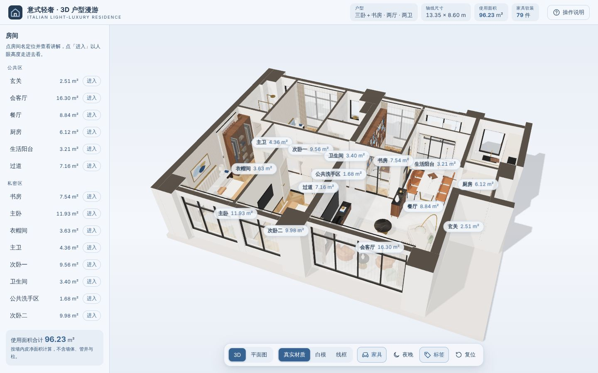
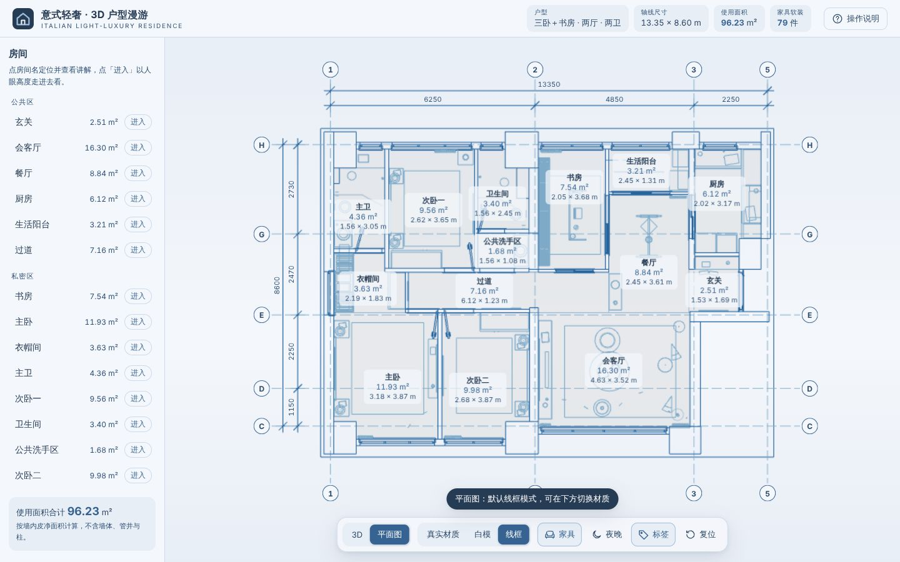
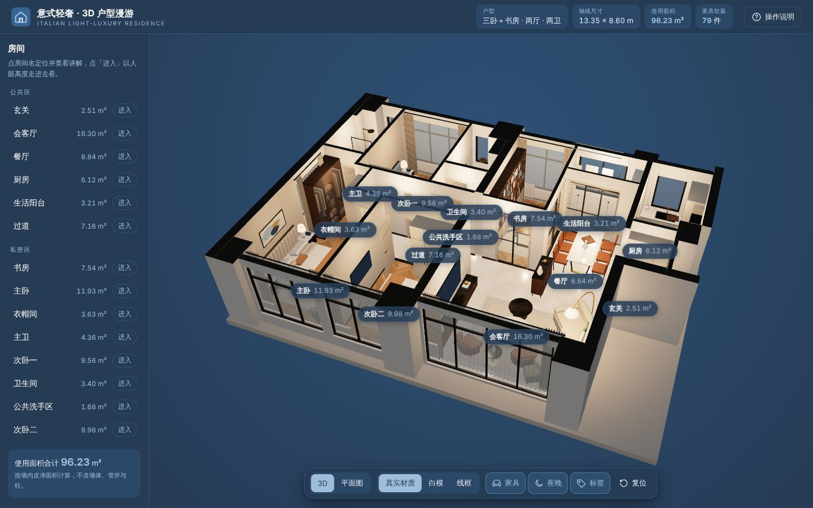
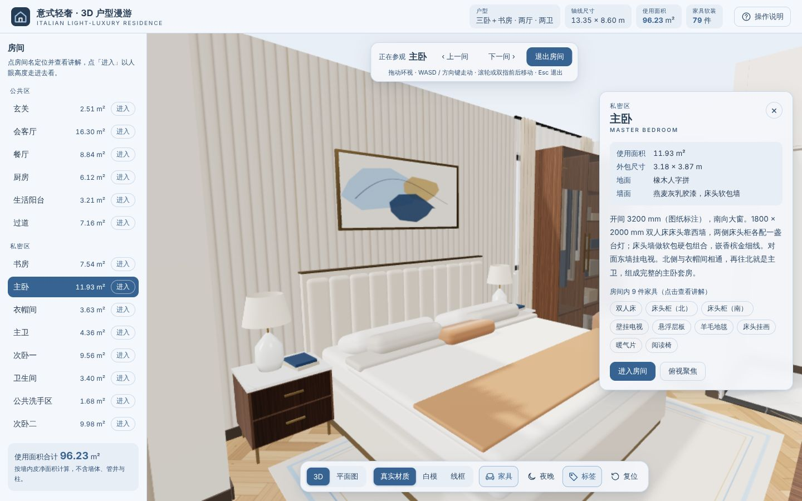

# 意式轻奢 · 3D 户型漫游

按用户上传的户型图，用 Three.js 搭建的可交互 3D 家居网页。墙体、门窗按图纸比例拉伸，不做天花板；每个房间、每件家具、每樘门窗都可以点选，查看名称、面积、尺寸、材质与中文讲解。界面使用 Loyel 渐变蓝色板。

| 3D 总览（真实材质） | 平面图（默认线框） |
|---|---|
|  |  |
| **夜晚：室内灯自动点亮** | **进入主卧（人眼高度）** |
|  |  |

## 打开方式

- **直接双击 `home3d/index.html`**，不需要服务器，也不需要联网。它是构建好的单文件版（约 750 KB）：three.js、全部脚本和样式都内联在这个文件里，贴图全部用 Canvas 现场绘制，不加载任何图片。联网时中文使用 Noto Sans SC，离线时回落到系统中文字体。
- 开发时改 `home3d/index.dev.html`、`home3d/js/`、`home3d/css/`，用本地服务器打开（ES Module 不能从 `file://` 加载），改完后重新生成单文件版：

```bash
npm install              # 安装 esbuild 与 three（只在构建时需要）
npm run home3d:start     # 本地服务器，打开 /home3d/index.dev.html
npm run home3d:build     # 重新生成单文件版 home3d/index.html
```

浏览器需要支持 WebGL2（近几年的 Chrome、Edge、Firefox、Safari 均可）。单文件版已用无界面 Chromium 从 `file://` 打开验证，控制台无报错。

## 能做什么

| 功能 | 操作 |
|---|---|
| 3D 总览 | 左键拖动旋转，滚轮 / 双指缩放，右键 / 双指拖动平移 |
| 点选讲解 | 单击地面或墙面 → 房间（使用面积、开间 × 进深、地面与墙面材质、讲解、房内家具清单）；单击家具 → 尺寸、材质、讲解；单击门窗 → 洞口尺寸、连接哪两个房间 |
| 开关门 | 单击门选中，再点一次开门 / 关门；推拉门同理（书房东侧推拉门默认打开） |
| 三种渲染模式 | 底部「真实材质 / 白模 / 线框」，快捷键 `1` `2` `3` |
| 显示 / 隐藏家具 | 底部「家具」，快捷键 `F`；隐藏后只看空间与硬装 |
| 白天 / 夜晚 | 底部「夜晚」，快捷键 `N`。夜晚时太阳关闭，16 处房间灯、台灯、吊灯、落地灯和柜内灯带**自动点亮** |
| 进入房间 | 双击房间地面，或左侧列表点「进入」。在房间里拖动环视，`W A S D` / 方向键走动，滚轮或双指前后移动，顶部条可切到上一间 / 下一间，`Esc` 退出 |
| 平面图 | 底部「平面图」，快捷键 `P`。正交俯视，**默认切到线框模式**，带轴号、分尺寸与总尺寸线，房间标签显示名称、面积和尺寸；回到 3D 时恢复原来的渲染模式 |
| 其他 | 「标签」（`L`）开关房间标签，「复位」（`R`）回到总览，右上角「操作说明」 |

手机上左侧房间列表收进左上角「房间」抽屉，讲解面板变成底部卡片。

## 尺寸从哪里来

坐标单位为毫米，原点在 ①轴 与 Ⓗ轴 交点，X 向东（图纸右方），Z 向南（图纸下方），Y 向上。

1. **轴网定比例**：①–②–③–⑤ = 6250 / 4850 / 2250，Ⓗ–Ⓖ–Ⓔ–Ⓓ–Ⓒ = 2730 / 2470 / 2250 / 1150，总尺寸 13350 × 8600 mm，图纸约 12.9 mm / 像素。
2. **分尺寸校正**：再用图上标注的分尺寸逐个校正墙线，例如主卧开间 3200、次卧二开间 2650、客厅 4650 × 约 3550、书房 2050 × 约 3700、餐厅就餐区 2500 × 2400、厨房通道 1390 + 台面 600、过道净宽 1100、主卫淋浴 1350 × 900。
3. **墙体**：承重墙与柱（图中涂黑）、外墙窗间墙、内隔墙分三类，洞口（门、推拉门、窗、垭口）按位置把墙切开。墙高按 2.80 m，门高 2.10 m。

各房间的使用面积由墙内皮多边形自动计算（不含墙体、管井与柱）：

| 房间 | 分区 | 使用面积 (m²) | 开间 × 进深 (m) | 家具 / 软装 |
|---|---|---|---|---|
| 玄关 | 公共区 | 2.51 | 1.53 × 1.69（外包） | 3 |
| 会客厅 | 公共区 | 16.30 | 4.63 × 3.52 | 14 |
| 餐厅 | 公共区 | 8.84 | 2.45 × 3.61 | 10 |
| 厨房 | 公共区 | 6.12 | 2.02 × 3.17（外包） | 6 |
| 生活阳台 | 公共区 | 3.21 | 2.45 × 1.31 | 4 |
| 过道 | 公共区 | 7.16 | 6.12 × 1.23（外包） | 2 |
| 书房 | 私密区 | 7.54 | 2.05 × 3.68 | 5 |
| 主卧 | 私密区 | 11.93 | 3.18 × 3.87（外包） | 9 |
| 衣帽间 | 私密区 | 3.63 | 2.19 × 1.83（外包） | 3 |
| 主卫 | 私密区 | 4.36 | 1.56 × 3.05（外包） | 4 |
| 次卧一 | 私密区 | 9.56 | 2.62 × 3.65 | 8 |
| 卫生间 | 私密区 | 3.40 | 1.56 × 2.45（外包） | 3 |
| 公共洗手区 | 私密区 | 1.68 | 1.56 × 1.08 | 1 |
| 次卧二 | 私密区 | 9.98 | 2.68 × 3.87（外包） | 7 |
| **合计** | | **96.23** | | **79** |

「外包」表示房间不是矩形，给出的是外接矩形尺寸。

**需要说明的推断**（图纸上没有直接标注，讲解里也做了说明）：

- 墙高 2.80 m、门高 2.10 m、窗台高度按常见住宅取值。
- 家具布置以图纸上画出的家具为准，材质、配色和软装（地毯、挂画、绿植、窗帘等）是意式轻奢风格的设计方案。
- 次卧一窗边的方块按「暖气分集水器检修位」处理，做成与墙同色的检修柜。
- 门的开启方向按图上的门弧线绘制；推拉门扇数按洞口宽度估计。

## 材质方案（真实材质模式）

- 地面：客餐厅、过道为鱼肚白大理石 600 × 1200；玄关为卡拉卡塔菱形铺 + 黑金花嵌花；卧室、书房、衣帽间为橡木人字拼；厨卫、阳台为石材砖。
- 墙面：暖白 / 燕麦灰乳胶漆；客厅西墙整面大理石背景墙；卧室床头软包墙；卫生间 2.4 m 以下通铺大理石纹瓷砖。
- 家具：胡桃木、奶咖烤漆、香槟金五金、丝绒与皮革、大理石台面。
- 所有贴图（大理石、人字拼、瓷砖、地毯、面料、挂画）都由 `js/textures.js` 用 Canvas 程序化生成，无缝平铺，按真实尺寸设置重复次数。

## 目录结构

```
home3d/index.html          单文件版（构建产物，可直接双击打开）
home3d/index.dev.html      开发用页面结构
home3d/css/style.css       样式（Loyel 色板 token、白天 / 夜晚主题、讲解面板、底部控制条、手机布局）
home3d/js/plan-data.js     户型数据：轴网、墙体与洞口、门、推拉门、房间多边形与讲解、79 件家具、房间灯位
home3d/js/architecture.js  楼板、墙体（按洞口切分）、墙面饰面、踢脚线、门窗、过门石、窗帘
home3d/js/furniture.js     家具建模（床、沙发、餐桌椅、橱柜、卫浴、挂画等 39 种类型）
home3d/js/textures.js      程序化贴图
home3d/js/materials.js     材质库：同一构件在真实材质 / 白模 / 线框三种模式下的材质
home3d/js/lighting.js      白天（天空光 + 太阳投影）与夜晚（月光 + 室内灯）
home3d/js/views.js         3D 总览、平面图正交相机、进入房间的环视与行走
home3d/js/ui.js            房间列表、讲解面板、悬停提示、房间标签、平面图标注
home3d/js/main.js          入口：点选、高亮、模式切换、平面图轴号与尺寸线、快捷键
home3d/js/geo.js           几何小工具（真实尺寸 UV、静态网格合并）
home3d/docs/               README 用的截图
tools/build-home3d.mjs     生成单文件版
```

## 改户型或加家具

1. 墙、门窗、房间都在 `js/plan-data.js`：墙是一个 `x/z` 范围（毫米）加 `open` 洞口列表；房间是墙内皮多边形，面积自动计算。
2. 家具在 `FURNITURE` 里加一行（中心点 `x, z`、朝向 `rot`、尺寸、材质与讲解）；新类型在 `js/furniture.js` 的 `BUILDERS` 里加一个建模函数。
3. `npm run home3d:build` 重新生成 `index.html`。

## 性能

- 静态构件按材质合并（约 1500 个网格合并到约 600 个），绘制次数减半。
- 帧率不足时自动降低像素比，流畅时恢复；手机上贴图与阴影贴图自动降到 512 / 1024。
- 首次显示前预编译着色器；夜晚第一次切换时会再编译一次带室内灯的着色器，可能有一瞬间停顿。
