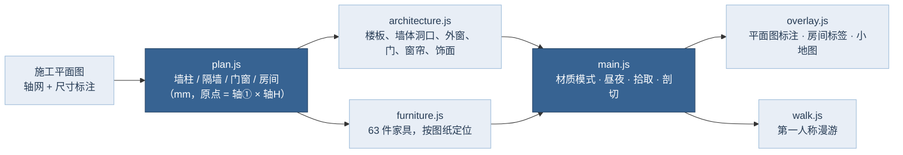

# 轻奢四居 · 3D 户型

按施工平面图 1:1 搭建的四室两厅两卫三维户型网页。模型没有天花板，可以从上方直接看进每个房间；所有墙柱、门窗、家具的位置都取自图纸的轴网与尺寸标注。

## 打开方式

- **直接双击 `home3d/index.html`**。它是构建好的单文件版（约 830 KB）：three.js、全部脚本、样式和拉丁字体都内联在里面，不需要服务器，也不需要联网。联网时中文使用 Noto Serif SC / Noto Sans SC，离线时回落到系统中文字体。
- 浏览器需要支持 WebGL2（近几年的 Chrome、Edge、Safari、Firefox 均可）。
- 开发时修改 `home3d/src/` 与 `home3d/index.dev.html`，用本地服务器打开，改完重新构建：

```bash
npm install            # 安装 three 与 esbuild（只在构建时需要）
npm run start:home     # 本地服务器，打开 /home3d/index.dev.html
npm run build:home     # 重新生成单文件版 home3d/index.html
```

## 功能

| 功能 | 操作 |
|---|---|
| 三种模型样式 | 顶栏「真实材质 / 白模 / 线框」，快捷键 `1` `2` `3` |
| 平面图 | 「平面图」或 `P`：正交俯视，默认切到线框，附轴网①②③⑤ / H G E D C、两道尺寸线（单位 mm）、墙体填充图例；拖动平移、滚轮或双指缩放 |
| 昼夜 | 「日景 / 夜景」或 `N`：夜间关闭阳光，室内 2700K 暖光与台灯、灯带、吊灯自动点亮，并加辉光 |
| 显示 / 隐藏家具 | 「家具」或 `F` |
| 半高墙 | 「半高墙」或 `C`：墙、门窗、窗帘在 1.2 m 处剖切，墙顶出现深色剖切面 |
| 房间讲解 | 左侧列表、房间标签或直接点地面：面积、尺寸、朝向、设计要点、家具清单 |
| 家具讲解 | 点击任意家具：尺寸、材质与对应图纸的说明，角标框标出选中对象 |
| 单独查看 | 房间卡片里的「单独查看」：只保留该房间（含四周墙体），其余部分被剖掉 |
| 进入漫游 | 房间卡片里的「进入漫游」：1.6 m 视高第一人称，拖动环视，`W A S D` / 方向键行走，`Shift` 加速，点地面走过去；手机上有方向键；左下角小地图显示位置与朝向；墙体、固定玻璃、家具都有碰撞 |
| 门 | 点击门开关（平开门转动、推拉门滑动） |
| 其他 | `L` 标签，`R` 复位视角，`Esc` 退出漫游 / 单独查看 / 关闭卡片 |

界面配色使用 Loyel 渐变蓝（#F4F7FB → #263B54），并随昼夜切换深浅。

## 尺寸从哪里来



- **坐标系**：X 向东、Z 向南，原点是轴线①与 H 的交点，单位 mm。轴网 ①–② 6250、②–③ 4850、③–⑤ 2250（总 13350）；H–G 2730、G–E 2470、E–D 2250、D–C 1150（总 8600）。
- **有标注的尺寸**直接采用，例如：客厅电视柜深 400、柜到圆几 1165、圆几 Ø1200、几到沙发 990、沙发座深 895；餐桌 1800 × 800、两侧拉椅 850；书房 350 | 550 | 600 | 550 与 1100 | 1700 | 900；主卫淋浴 1350 × 900；卫生间淋浴 1240 × 950；厨房水槽距墙 510、槽宽 750、通道 1390 × 1810；玄关 1360 × 1300、鞋柜深 400。
- **没有标注的墙厚与洞口**按图纸比例（约 12.9 mm / 像素）量取后取整到 10 mm，误差一般在 ±50 mm 以内。

| 房间 | 面积 m² | 尺寸 |
|---|---:|---|
| 会客厅 | 16.3 | 开间 4650 × 进深 3550 |
| 主卧 | 11.9 | 3240 × 3800 |
| 次卧一 | 10.2 | 2650 × 3850 |
| 次卧二 | 9.7 | 2650 × 3800 |
| 书房 | 7.6 | 2050 × 3700 |
| 过厅 | 6.3 | 宽 1100–1300 |
| 餐厅 | 6.1 | 2500 × 2400 |
| 厨房 | 6.1 | 通道 1390 × 1810 |
| 卫生间（含干区） | 5.2 | 淋浴 1240 × 950 |
| 走廊 | 4.7 | 净宽 1100 |
| 主卫 | 4.6 | 淋浴 1350 × 900 |
| 生活阳台（含洗衣位） | 3.3 | 1870 × 1300 + 600 × 1300 |
| 衣帽间 | 2.8 | 通道 900 |
| 玄关 | 2.6 | 1360 × 1300 |
| **合计** | **97.5** | 按地面矩形计算，不含墙体 |

## 图纸上没有、由我设定的内容

图纸是平面图，以下高度与做法属于设计假设，可在 `src/plan.js` 里修改：

- 室内净高 2800，门高 2100（入户门 2200），推拉门 2300–2400。
- 窗台高度：客厅 100（落地窗），卧室南窗 300，次卧一 / 书房 / 阳台北窗 450，卫生间 900，厨房 1050。
- 厨房入口：西墙推拉门（800 宽），门扇打开时停在餐厅一侧、冰箱外侧。
- 洗衣凹位：按图中尺寸链判断为朝阳台开口，洗衣池与洗衣机面向阳台。
- 外墙外侧的斜线区域按“非本户 / 外飘板”处理，只画成楼板。
- 意式轻奢材质：暖白大理石大板地面、人字拼橡木、胡桃木、拉丝香槟金与深古铜五金、干邑色皮革；全部贴图用 Canvas 现场生成，不依赖外部图片。

## 文件

```
home3d/
├─ index.html          构建好的单文件版（双击打开）
├─ index.dev.html      开发模板（import map 指向 node_modules/three）
├─ src/
│  ├─ plan.js          户型数据：墙柱、隔墙、门窗、房间、讲解文案
│  ├─ architecture.js  楼板、墙体、外窗、门、窗帘、墙面饰面、墙顶剖切面
│  ├─ furniture.js     家具与软装（每件都带尺寸、材质、讲解）
│  ├─ materials.js     材质库：真实 / 白模 / 线框，夜间发光
│  ├─ textures.js      程序化贴图：大理石、人字拼、木皮、织物、地毯、挂画
│  ├─ kit.js           几何工具：米制 UV、零件合并、棱线
│  ├─ overlay.js       平面图标注、房间标签、小地图
│  ├─ walk.js          第一人称漫游
│  ├─ main.js          入口：场景、相机、昼夜、拾取、剖切、界面
│  └─ style.css        界面样式
└─ tools/build.mjs     打包为单文件
```
