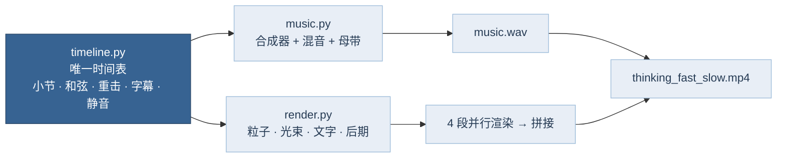

# 思考，快与慢 · 浓缩视频（光 · 影 · 荧光粒子）

把丹尼尔·卡尼曼《思考，快与慢》（*Thinking, Fast and Slow*，2011）浓缩成一支约 2 分 54 秒的“燃”系视频。画面和配乐都由本目录的代码从零生成：没有素材、没有采样、没有版权音乐。

| 项目 | 规格 |
|---|---|
| 时长 | 174 s（108 小节 + 1.2 s 黑场） |
| 画面 | 1920 × 1080，30 fps，H.264 |
| 声音 | 48 kHz 立体声，AAC 256 kbps，整体响度约 −12 LUFS |
| 速度 / 调性 | 150 BPM，D 小调（1 拍 = 0.4 s = 12 帧，16 分音符 = 3 帧） |
| 配色 | Loyel 渐变蓝十档（`#F4F7FB` → `#263B54`），背景是 `#263B54` 压暗 |

## 卡点是怎么保证的



- **同一张时间表**：鼓谱（`drum_events()`）、47 个重击（`HITS`）、上升音、反向镲、军鼓滚奏、三次全静音和 142 条字幕都写在 `timeline.py` 里，单位是小节。配乐按采样点放声音，画面按帧号取同一时刻，两边没有任何手工对齐。
- **字幕自带音效**：字幕条目上的 `sfx`（`pop` 叮、`tick` 嗒、`whoosh` 嗖、`shimmer` 闪）由 `music.py` 收集后放到出字的那一刻；嗖声的峰值对准出字时刻，而不是起点。逐词弹出的字幕（如“快 · 自动 · 直觉 · 毫不费力”）每个词一声，音高取当下和弦的和弦音。
- **画面跟着鼓走**：底鼓 / 太鼓驱动粒子亮度脉冲和轻微推镜；军鼓驱动光束闪烁；每个重击按类型触发闪白、震屏、冲镜、横向镜头光晕和粒子冲击波。
- **静音前置**：21.0–21.5、59.5–60.0、99.5–100.0 小节整体静音（画面同时压暗、粒子冻结），随后的“错”、“失去。”和终章书名才砸下来。
- **实测**：用起音阈值法检测配乐中的重击与底鼓，起音相对时间表的偏差为 0–6 ms（底鼓中位 3.9 ms），都小于 1 帧（33 ms）。

## 分镜

| 时间 | 小节 | 段落 | 内容 | 配乐 | 画面 |
|---|---|---|---|---|---|
| 0:00 | 0–7 | 引子 | 你以为，你在思考。/ 其实，大多数时候—— / 是另一个你，在替你做决定。 | 低音长音、心跳（每 2 拍）、秒针、铃音动机、上升音 | 稀疏荧光尘埃逐渐增多，最后全部粒子内爆成一颗星核 |
| 0:12.8 | 8–11 | 书名 | 思考，快与慢 · 卡尼曼（1934–2024） | **Braam** + 冲击 + 次低音下潜 | 星核炸开、粒子聚成书名，文字向外放射光束，扫光 |
| 0:19.2 | 12–27 | 第一章 两个系统 | 系统 1 / 系统 2；球拍与球；“0.10 元？”→ **错**；50%+；系统 2 很懒 | 半拍律动、太鼓、弦乐八分断奏；21 小节磁带急停 + 半拍静音 | “1”由横向疾驰的流光粒子组成，“2”缓慢聚合；“错”带故障切片 |
| 0:44.8 | 28–47 | 第二章 启发法与偏差 | 锚定（10 → 25%，65 → 45%）、可得性（中风 vs 意外，80%）、琳达问题（85%–90%，A ⊃ B） | **第一次 drop**：全速鼓组、十六分断奏、合唱、侧链抽吸 | 粒子聚成“10”“65”“80%”、同心圆；44–47 小节每小节一个效应名，砸一下炸一下 |
| 1:16.8 | 48–59 | 第三章 过度自信 | WYSIATI、后见之明、规划谬误、专家直觉的三个条件；“我们最怕的，是——” | Breakdown：八音盒式分解和弦 → 56 小节起鼓与上升音回归 | 体积光从上方斜照，雾更浓；末尾粒子跃迁成放射流星 |
| 1:36.0 | 60–79 | 第四章 前景理论 | **失去。** 损失厌恶（1.5–2.5 倍）、参照点（杰克与吉尔）、框架效应（84% vs 50%）、禀赋 / 确定性 / 沉没成本 / 心理账户 | **主高潮**：铜管主旋律、全编制、braam | 粒子画出价值函数（λ = 2.25 的 S 形曲线）；第二组速闪 |
| 2:08.0 | 80–91 | 第五章 两个自我 | 体验自我 vs 记忆自我、峰终定律、冷水实验 | 半拍抒情：电钢琴弹主旋律 | 粒子画出“痛苦—时间”曲线并点亮峰值与结尾 |
| 2:27.2 | 92–103 | 终章 | 识别雷区 / 放慢脚步 / 召唤系统 2；快，是本能。慢，是能力。→ 书名 | 三连重击 + 太鼓齐奏、铜管再现；99.5 静音后终极 braam | 三连闪白震屏；书名在体积光中心重现 |
| 2:46.4 | 104–107 | 尾声 | 「当你正想着它的时候，生活中没有什么事，像你以为的那么重要。」 | 铃音动机、长音淡出 | 粒子渐稀，淡入黑场 |

## 画面是怎么做的（`render.py`）

- **粒子场**：16,000 个可聚形粒子 + 7,400 个远景微尘 + 600 个近景散景。每个粒子的位置是时间的解析函数：家位置 + 漂移 × “粒子时间” + 两组正弦游走 + 积分风场 × 深度视差，再对屏幕外留边取模。“粒子时间”是速度曲线的积分，所以静音时可以整体冻结，系统 1 那两小节可以整体加速并横向拉出流光。
- **运动模糊**：每帧取 t 和 t − 半帧两个位置，沿线段做亚像素双线性溅射，速度越快拖尾越长。
- **聚形**：字形（按与字幕完全相同的字体、字号和位置渲染遮罩后采样）、数字、同心圆、价值函数、峰终曲线。每个粒子带 0–0.12 s 随机延迟飞入；释放时按“爆散”（向外冲 + 闪亮，配合文字碎裂退场）或“消散”（缓慢上飘）退出。和字幕重叠的聚形粒子会压暗，只给字面加闪烁颗粒，避免把字糊成白块。
- **光**：1/4 分辨率的流动雾 + 角向噪声生成的体积光束；标题类文字做 26 次缩放叠加的径向模糊，形成“字里透出的光”；扫光带掠过章节标题；半分辨率金字塔辉光；只在高光上做横向镜头光晕。
- **影**：文字背后按字形做软阴影，把光雾压暗让字浮出来；暗角。逐帧胶片颗粒默认关闭（它会让码率翻倍），需要时用 `TFS_GRAIN=0.011` 打开。
- **闪帧**：重击当帧是 1–2 帧的闪白，约 0.2 s 内退去，字随即清晰可读。
- **色彩**：所有颜色只取 Loyel 十档；色调映射在 0.75 以上做软肩压缩，文字在色调映射之后用“覆盖”合成，保证字色就是色板值。
- **并行**：因为没有逐帧状态，整片切成 4 段由 4 个进程同时渲染，各自编码后无损拼接，再与配乐封装。

## 配乐是怎么做的（`music.py`）

全部是振荡器 + 噪声 + 滤波器现场合成：PolyBLEP 带限锯齿、超级锯齿（7 声部失谐）、FM 铃音与电钢琴、逐块时变双二阶滤波。

- **鼓**：底鼓（音高包络正弦 + 点击）、军鼓（音调 + 带通噪声 + 三连拍手）、808 式金属踩镲、太鼓与通鼓、镲片。
- **预告片元素**：braam（D1–F3 低音铜管簇，滤波器 50 ms 内打开再缓慢合拢 + 失真）、冲击（30–75 Hz 下扫正弦 + 碎裂噪声）、次低音下潜、按十六分→三十二分加速门限的上升音、混响倒放的反向镲、嗖声、下降音、故障音、磁带急停、碎玻璃。
- **音乐层**：Dm–B♭–F–C（i–VI–III–VII）进行，每和弦 2 小节；转段前用 Gm–A 制造属功能张力。弦乐断奏、超级锯齿铺底、共振峰滤波的“啊”声合唱、带颤音的铜管主旋律（含附点八分乒乓延迟）。
- **混音与母带**：按底鼓生成侧链包络让铺底和低音“抽吸”；各轨在参考窗口自动对齐到目标 RMS；大厅 / 房间两路卷积混响；低频搁架 −2.5 dB、高频搁架 +2.5 dB（照顾手机外放）；RMS 粘合压缩、软削波、前视限幅；按 ITU-R BS.1770 K 加权迭代到 −12 LUFS。

## 重新生成

依赖：Python 3（`numpy`、`scipy`、`opencv-python-headless`、`pillow`）、带 libx264 的 `ffmpeg`、Noto CJK 字体（Debian / Ubuntu：`fonts-noto-cjk`）和 Inter 字体（`fonts-inter`）。

```bash
pip install numpy scipy opencv-python-headless pillow
./build.sh                         # 先合成配乐，再 4 进程渲染并封装
python3 render.py --still 21.6 63  # 只导出某几个小节处的预览帧到 build/
```

在 4 核机器上，配乐约 2 分钟，画面约 20 分钟。输出在 `build/`（不进版本库）：`thinking_fast_slow.mp4`（1080p 主版）和 `thinking_fast_slow_720p.mp4`（便于手机和聊天软件分享）。

## 内容依据与边界

视频里的数字都取自原书或书中引用的原始研究：

| 画面里的说法 | 出处 |
|---|---|
| 球拍与球，超过一半的哈佛、MIT、普林斯顿学生答错 | 原书第 3 章；Frederick（2005）· *Journal of Economic Perspectives* · 认知反思测验 |
| 转盘停在 10 / 65 → 估计 25% / 45% | Tversky & Kahneman（1974）· *Science* · 锚定 |
| 中风致死约为全部意外的 2 倍，80% 的人却认为意外更常见 | 原书第 13 章；Lichtenstein 等（1978） |
| 琳达问题，85%–90% 的大学生选 B | Tversky & Kahneman（1983）· *Psychological Review* · 合取谬误 |
| 损失之痛 ≈ 同等收益之乐的 1.5–2.5 倍；曲线参数 α = 0.88、λ = 2.25 | 原书第 26 章；Kahneman & Tversky（1979）· *Econometrica*；Tversky & Kahneman（1992）· *Journal of Risk and Uncertainty* |
| 杰克和吉尔都有 500 万 | 原书第 25 章（伯努利的错误） |
| 存活率 90% vs 死亡率 10%：选手术的医生 84% vs 50% | 原书第 34 章；McNeil 等（1982）· *NEJM* |
| 专家直觉可信的条件 | Kahneman & Klein（2009）· *American Psychologist* |
| 冷水实验：多数人宁愿重来更长、但结尾稍好的那次 | Kahneman 等（1993）· *Psychological Science* |
| 识别雷区、放慢脚步、召唤系统 2 | 原书结论章 |
| 尾声引言 | 原书第 38 章（聚焦错觉） |

几点刻意的取舍：

- **【争议】没有放入“启动效应”和“自我损耗”**。原书第 4 章的社会启动研究和第 3 章引用的自我损耗研究，在后来的大规模重复实验中大多未能复现（如 Hagger 等，2016，*Perspectives on Psychological Science*，多实验室重复的效应量接近 0）。卡尼曼本人在 2017 年也公开承认第 4 章过度依赖了样本量不足的研究。视频只选用了重复性较好的发现。
- **【争议】损失厌恶的倍数**：不同研究估计差异较大，有学者质疑其普遍性（Gal & Rucker，2018）；一项 2024 年的荟萃分析估计均值约 2 倍（Brown 等，*Journal of Economic Literature*）。画面里用的是原书给出的区间 1.5–2.5 倍。[中等证据]
- **“系统 1 / 系统 2”是比喻**。卡尼曼在书中明确说它们是“虚构的角色”，用来描述两类思维方式，并不对应两个脑区。
- “快，是本能。慢，是能力。”是本片对全书的概括性文案，不是书中原话。
